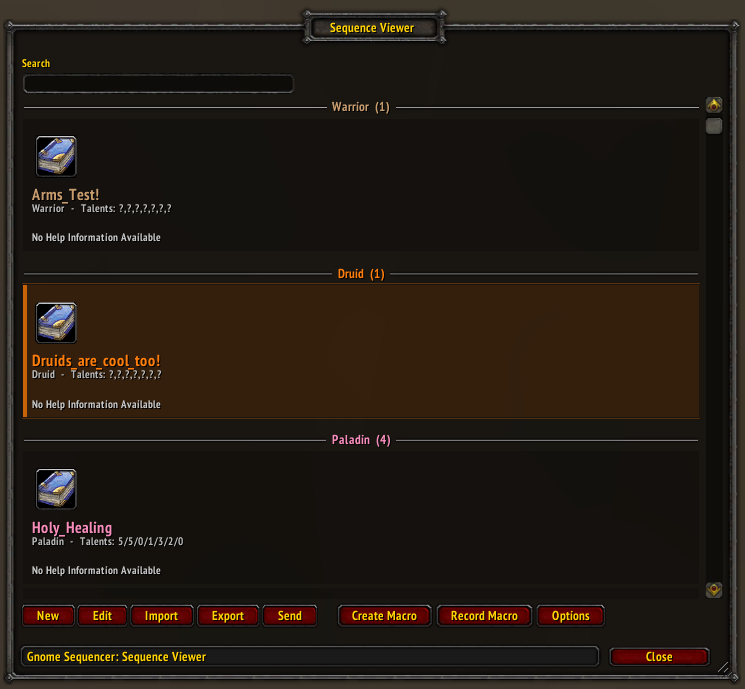

# Gnome Sequencer Enhanced (GSE) - Revival for WoW 3.3.5a

A revival, restoration, and enhancement of Gnome Sequencer Enhanced for World of Warcraft 3.3.5a (Wrath of the Lich King).



## About

GSE (Gnome Sequencer Enhanced) is an advanced macro sequencer for World of Warcraft that allows players to create and execute complex macro sequences, bypassing normal macro limitations. This version has been specifically restored and fixed for WoW 3.3.5a compatibility.

**Original Author**: TimothyLuke  
**WotLK Backport**: Gummed (Warmane) - abandoned  
**Maintainer**: cerberus (2025 revival)  
**2026 Maintenance**: [dennyp02](https://github.com/dennyp02)

## Features

- Create complex macro sequences that execute with a single button press
- Bypass the 255-character macro limit
- Conditional execution for PvP, Raid, Dungeon, Heroic and Party
- Import/export sequences for sharing
- Translation-ready: English is complete; other locale files are partial and fall back to English
- Sample macros included for all classes
- Redesigned Sequence Viewer with compact class-coloured cards, live search and clear help/talent metadata
- Minimap button: left-click opens `/gse`, right-click opens a command menu; draggable and hideable
- Rename sequences in place, with duplicate-name protection
- ElvUI-friendly: GSE's AceGUI is isolated from ElvUI and other addons
- More reliable saves: sanitized data, `/gse repair` and corrected manual-save overwrites
- Full GUI for sequence management (Viewer, Editor, Import, Export and Transmission)

## Installation

1. Download the latest release.
2. Extract the `GSE`, `GSE_GUI` and `GSE_LDB` folders into your `World of Warcraft/Interface/AddOns/` directory.
3. Ensure the folder structure looks like:
   ```
   Interface/
   └── AddOns/
       ├── GSE/
       ├── GSE_GUI/
       └── GSE_LDB/
   ```
4. Enable all three GSE modules in your addon selection screen.
5. `/reload` (or restart the client).

**Notes**
- `GSE` and `GSE_GUI` provide the core and the interface. `GSE_LDB` is required for the minimap button and LDB integration; if it is disabled, use `/gse` to open the interface.
- ElvUI is optional. GSE works with and without it.

## Usage

### Basic Commands
- `/gse` - Open the Sequence Viewer
- `/gse help` - Show help information
- `/gse showspec` - Show your current specialization
- `/gse loadsamples` - Load sample macros for your class
- `/gse debug` - Open the sequence debugger

Maintenance commands:
- `/gse repair` - Scan saved sequences and remove corrupt entries
- `/gse cleanorphans` (or `/gse clean`) - Delete orphaned GS-E macros
- `/gse checkmacrosforerrors` - Check macros for corrupt versions
- `/gse resetoptions` - Reset GSE options to defaults

The same commands are available from the minimap button's right-click menu.

### Creating Your First Macro
1. Type `/gse` to open the Sequence Viewer.
2. Click **New**.
3. Give your sequence a name. Duplicate sequence or macro names are blocked.
4. Add your macro commands in the editor, then click **Save**.
5. Select the sequence in the Viewer and click **Create Macro**.
6. Drag the macro icon from the card to your action bar.

**Viewer tips**
- Left-click a card to select it; right-click to open it in the editor.
- Use the search box to filter by sequence name, class, help text or talents.
- Sequences are grouped by class and use class colours.

### Sample Macros
The addon includes documented sample macros for all classes. Load the samples for your current class with `/gse loadsamples`; they appear in the Viewer grouped by class. Examples include:
- Warrior: Arms DPS, Protection Tank
- Paladin: Retribution DPS, Holy Healing
- Hunter: Beast Mastery, Marksmanship
- And more for all classes!

Samples are starting points: review the help text and talents, then adjust them to your gear and playstyle.

## What's Been Fixed

This revival addresses numerous issues from the abandoned original. The 2025 revival work is preserved below, followed by the current 2.2.06 fixes.

### Critical Fixes
- Fixed 20+ typos and naming errors that caused crashes
- Added comprehensive nil checking to prevent errors
- Full WoW 3.3.5a API compatibility (removed modern API calls)
- Fixed global variable pollution
- Removed 17,548 lines of duplicate code (5MB+ reduction)
- Fixed performance issues with caching and string operations

### Compatibility Updates
- Removed unsupported events (GROUP_ROSTER_UPDATE, PLAYER_SPECIALIZATION_CHANGED)
- Fixed difficulty checks for 3.3.5a
- Updated talent system detection for pre-MoP design
- Removed BackdropTemplateMixin usage

### New Features
- Added comprehensive sample macros for all classes
- Improved error handling and user messages
- Better defensive programming throughout

### 2.2.06 Fixes
- Isolated GSE's AceGUI into a private namespace so ElvUI and other addons cannot override the editor widgets
- Reworked the Editor and Viewer layouts with native AceGUI sizing and proper resize handling
- Redesigned the Sequence Viewer with compact class-coloured cards, live search and clearer selection
- Added a minimap button with a right-click `/gse` command menu, plus a Show Minimap Button option
- Added in-place sequence renaming and duplicate-name protection for sequences and macros
- Fixed manual-save overwrites, added saved-data sanitizing and `/gse repair`, and corrected the out-of-combat queue timer
- Fixed popup stacking above AceGUI frames, `/gse showspec` and the Create Macro guard
- All GSE windows now open centered on the screen

## Technical Details

Built using:
- Ace3 Framework
- LibStub for library management
- LibDataBroker for minimap integration
- Lua 5.1 (WoW 3.3.5a embedded)

**Modules**
- `GSE` - core addon: sequence storage, API, options, localization and libraries
- `GSE_GUI` - interface: Sequence Viewer, Editor, Import/Export, Transmission, Recorder and related windows
- `GSE_LDB` - LibDataBroker data source and the LibDBIcon minimap button

## Known Limitations

- Some operations fail during combat due to Blizzard's combat lockdown
- English is complete; Chinese, Russian, German, French and Spanish locale files are partial and fall back to English
- WoW 3.3.5a macro names are limited to 16 characters, so keep sequence names within that limit if you use a macro stub
- The minimap button requires GSE_LDB
- Spec detection uses talent tree analysis (pre-specialization era)
- Maximum of 18 character macros + 120 account macros

## Contributing

The 2025 revival was done by cerberus after Gummed's WotLK backport was abandoned. The 2.2.06 ElvUI, save, Viewer and minimap work was done by [dennyp02](https://github.com/dennyp02). TimothyLuke continues to maintain GSE for retail WoW. Contributions are welcome!

### Development Guidelines
1. Maintain WoW 3.3.5a compatibility
2. Always use local variables (avoid globals)
3. Add nil checks for all WoW API calls
4. Test with ElvUI enabled and disabled
5. Keep user-facing strings in `L[...]` and add new keys to `ModL_enUS.lua`
6. Update `GSE/CHANGELOG.md` for user-facing changes

## Version History

- **2.2.06-wotlk** (2026) - ElvUI compatibility, UI, minimap and save fixes
  - Isolated GSE's AceGUI so ElvUI and other addons cannot override the sequence editor's widgets
  - Reworked the Editor and Viewer layouts with native AceGUI sizing and resize handling
  - Redesigned the Sequence Viewer with compact class-coloured cards, live search and clearer selection/padding
  - Added a minimap button with a right-click `/gse` command menu and a Show Minimap Button option
  - Added in-place sequence renaming and duplicate-name protection for sequences and macros
  - Moved the out-of-combat save queue off the shared AceTimer library
  - Added missing enUS localization strings
  - Added saved-data sanitizing on login and `/gse repair`
  - Fixed generated sequence names creating empty placeholder entries
  - Fixed manual saves being ignored after the first save
  - Fixed popup stacking above AceGUI frames, `/gse showspec` and Create Macro errors
  - All GSE windows now open centered on the screen

- **2.2.04-wotlk** (January 2025) - Complete revival for 3.3.5a by cerberus
  - Fixed all critical bugs and crashes
  - Added sample macros for all classes
  - Full compatibility restoration
  - Based on Gummed's backport of GSE 2.x
  
- **2.2.03** - Last known version backported to 3.3.5a by Gummed (abandoned)

Note: Current retail GSE is version 3.2.x and is a complete rewrite by TimothyLuke

## License

Original GSE by TimothyLuke is released under the MIT License.  
This WotLK backport and revival maintains the same open-source spirit.  
See https://github.com/TimothyLuke/GSE-Advanced-Macro-Compiler for the original project.

## Support

This revival is maintained by cerberus. The 2.2.06 maintenance is handled by [dennyp02](https://github.com/dennyp02). For issues:
1. Check the [Issues tab](https://github.com/dennyp02/GSE-WotLK-3.3.5a/issues) on GitHub
2. Provide clear reproduction steps
3. Include any error messages
4. Note your class/spec when reporting

## Acknowledgments

- **TimothyLuke** - Original author of GSE (still maintains retail version)
- **Gummed** - Created the WotLK 3.3.5a backport
- **cerberus** - Laid the groundwork with the 2025 3.3.5a revival
- **semlar** - Original GnomeSequencer creator
- **SkomsProcGlow** - AceGUI widget reference
- WoW addon community for keeping classic alive

---

*This addon is not affiliated with or endorsed by Blizzard Entertainment.*
